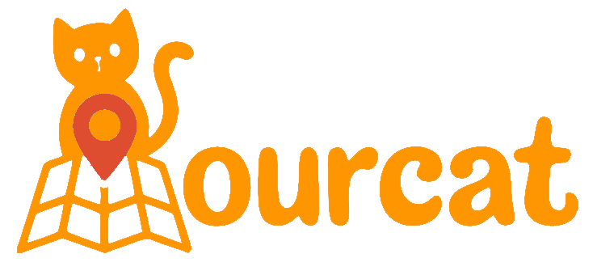

<p align="center"></p>

# OurCat Backend

这是我的毕业设计 OurCat（校园猫谱）的后端：记录校园流浪猫、组织救助、发布帖子和交流观察记录。Android 客户端在 [OurCat Android](https://github.com/BlackCoder0/OurCat_Android)。项目使用 Java、Spring Boot 2.7、JPA，生产数据库为 MySQL 8。

开源用于学习交流。运行者使用自己的后端、账号和数据；仓库不提供作者的公共云端实例。

## 先体验，或从源码运行

Windows 本地体验包包含 Java 运行时、后端和 Demo APK，启动与备份方法见 [本地体验教程](docs/local-experience.md)。当前包仍在预发布验证阶段，实体手机和未安装开发环境的其他电脑尚未验收；公开下载以仓库 [Releases](https://github.com/BlackCoder0/OurCat_backend/releases) 中实际存在的附件为准。

从源码启动需要 JDK 11 或更高版本、Maven；本机验证环境为 JDK 17：

```powershell
git clone https://github.com/BlackCoder0/OurCat_backend.git
cd OurCat_backend
$env:OURCAT_DEMO_JWT_SECRET = [guid]::NewGuid().ToString('N') + [guid]::NewGuid().ToString('N')
mvn spring-boot:run '-Dspring-boot.run.profiles=demo'
```

看到 `Started OurCatApplication` 后，在电脑打开 `http://localhost:8080/api/auth/captcha`，应返回验证码图片和 key。手机端用 Demo APK 设置电脑局域网地址；Android 模拟器使用 `http://10.0.2.2:8080/`。管理员初始化、目录和排错见教程。

## 本地版现在能做什么

| 能力 | demo 行为 |
| --- | --- |
| 账号与内容 | 注册本地账号，浏览示例猫咪、帖子和救助活动，发布自己的内容 |
| 组织与救助 | 管理员审核加入、分配任务，成员申领、写日志、提交完成汇报 |
| 图片 | 写入本地目录；支持 JPEG/PNG/GIF，每张最多 10 MiB、2000 万像素 |
| 数据 | 文件 H2 位于 `data/demo`，重启保留；dev 内存库则在重启后清空 |
| AI | 默认关闭，不调用作者的服务；文本匹配保留 |
| 地图与定位 | Demo APK 不内置地图 Key，上报使用明确标注的示例位置 |
| 天气 | 基础天气仍需联网；demo 不接入带个人凭据的官方天气服务 |

生产版继续使用 MySQL、Flyway、OSS 和个人配置。demo 只能单独启用，启动保护拒绝生产数据源、混用 Profile、开启 AI 或携带 OSS/和风凭据。发布源码不会自动部署作者服务器。

## 深入研究

| 文档 | 内容 |
| --- | --- |
| [本地体验](docs/local-experience.md) | 启动、手机连接、管理员、图片、停止与备份、打包 |
| [配置与部署](docs/configuration.md) | dev/生产环境、外部配置、数据库和第三方服务 |
| [API 速查](docs/api.md) | 认证、猫咪、社区、组织、救助与上传接口 |
| [源码阅读](docs/architecture.md) | 一次猫咪上报的调用链、匹配限制、数据关系 |
| [验证记录](docs/validation.md) | 实际测试范围与未测项目 |

验证命令为 `mvn test` 和 `mvn package`。测试包括 demo 隔离、初始化幂等、图片校验和组织救助操作链；不能据此宣称生产 MySQL 或所有手机都已验证。

## 反馈与许可

欢迎在 [Issues](https://github.com/BlackCoder0/OurCat_backend/issues) 讨论复现步骤和源码问题。请附版本、操作步骤和经过脱敏的错误日志。

OurCat 代码使用 [MIT](LICENSE)。依赖和所附 Java 运行时保留各自许可证；运行时条款见发行包的 `runtime/legal`。

OurCat is a graduation project for campus stray-cat records, rescue coordination and discussion. Run your own backend; there is no shared public service. The documentation is primarily in Chinese.
