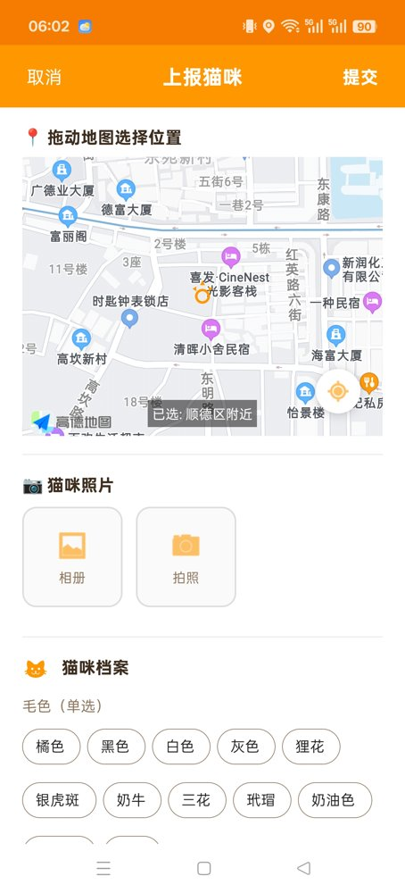
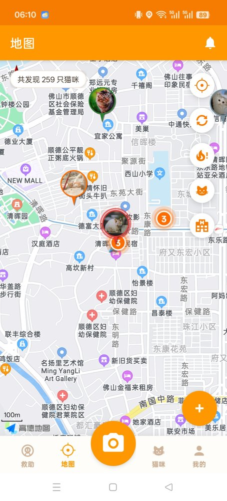
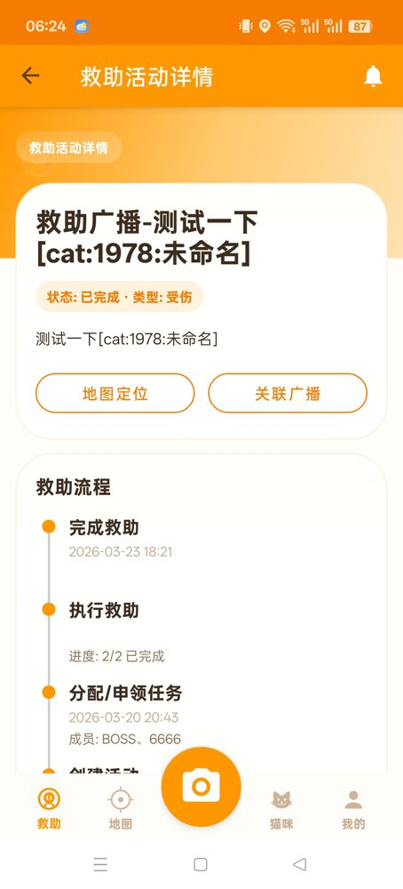
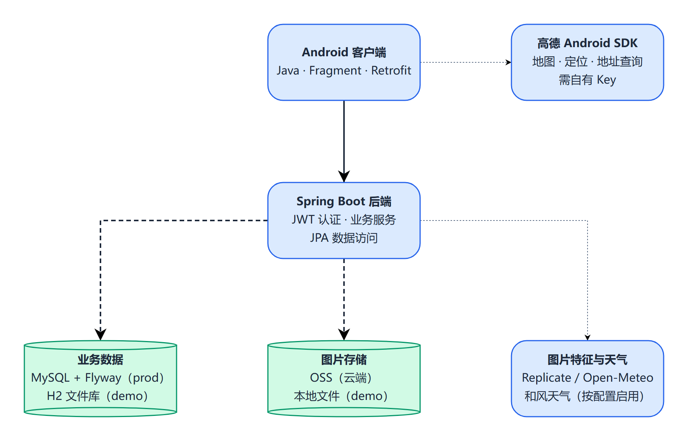
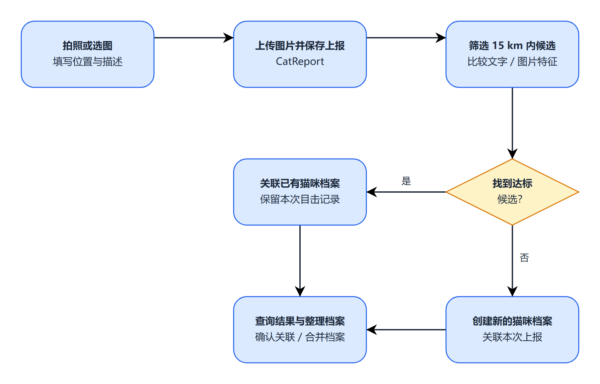
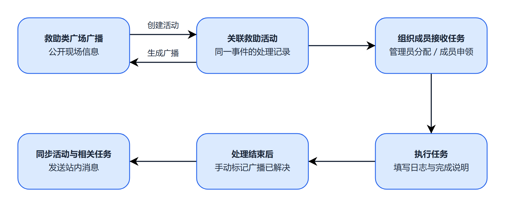

<p align="center"></p>

# OurCat Backend · 校园猫谱后端

OurCat 是采用 **Android + Spring Boot + MySQL** 实现的校园流浪猫综合救助平台，也是一个可从源码研究的全栈毕业设计。主要功能包括猫咪上报与建档、地图查看、求助广播、志愿者任务和社区讨论。

项目针对三个具体问题展开：同一只猫的照片和位置散落在不同记录里，文字描述难以找到现场，发出求助后缺少后续处理记录。因此，系统以猫咪档案保存长期信息，以目击上报记录每次发现，再用救助活动、任务和日志记录分工与结果。

本仓库提供 REST API、业务服务和数据库迁移；客户端位于 [OurCat Android](https://github.com/BlackCoder0/OurCat_Android)。公开版本需要运行各自的后端，账号和内容保存在对应实例中。

**[下载 Windows 体验包与 APK](https://github.com/BlackCoder0/OurCat_backend/releases/tag/v0.1.0-local-preview.1)** · [第一次运行](docs/local-experience.md) · [API 文档](docs/api.md)

[运行体验](#运行体验) · [功能与场景](#功能与场景) · [技术栈](#技术栈) · [系统结构](#系统结构) · [核心流程](#核心流程) · [设计亮点](#设计亮点) · [源码与文档](#源码与文档)

## 界面展示

| 猫咪上报 | 地图分布 | 救助活动 |
| :---: | :---: | :---: |
|  |  |  |

截图来自已配置地图等服务的客户端。[完整界面图集](https://github.com/BlackCoder0/OurCat_Android/blob/main/docs/screenshots.md)按功能分类；下方本地体验包的地图、定位和图片 AI 有单独限制。

## 运行体验

### 下载体验包

[本地体验版 Release](https://github.com/BlackCoder0/OurCat_backend/releases/tag/v0.1.0-local-preview.1) 提供 Windows 10/11 x64 后端包和配套 Android APK。ZIP 内已包含 Java 运行时，不需要另装 JDK、Maven 或 Android Studio。

1. 下载并完整解压 `OurCat-demo-windows-x64-preview1.zip`，双击 `start.cmd`。
2. 等窗口出现 `Started OurCatApplication`，把包内 `OurCat-demo.apk` 安装到安卓手机。
3. 手机与电脑接入同一 Wi-Fi，在登录页设置电脑的局域网地址；模拟器使用 `http://10.0.2.2:8080/`。
4. 注册普通账号，或使用 `data/login-info.txt` 中本机生成的管理员账号登录。启动窗口需要保持打开。

地址选择、端口占用、停止程序与备份步骤见[本地体验教程](docs/local-experience.md)。电脑停止服务后，手机将无法访问该本地实例。

### 从源码启动

需要 JDK 11 或更高版本、Maven；已有构建验证使用 JDK 17。

```powershell
git clone https://github.com/BlackCoder0/OurCat_backend.git
cd OurCat_backend
$env:OURCAT_DEMO_JWT_SECRET = [guid]::NewGuid().ToString('N') + [guid]::NewGuid().ToString('N')
mvn spring-boot:run '-Dspring-boot.run.profiles=demo'
```

启动后访问 `http://localhost:8080/api/auth/captcha`，可检查验证码接口。首次管理员设置和环境变量说明见[源码运行步骤](docs/local-experience.md#从源码运行)。

## 功能与场景

| 模块 | 已实现内容 | 使用场景 |
| --- | --- | --- |
| 账号与组织 | 图片验证码、注册登录、资料和头像、组织加入申请、审核与成员管理 | 区分普通用户、志愿者和管理员的操作范围 |
| 猫咪记录 | 照片、位置、毛色、特征和性格上报；档案查询、上报记录、确认与合并 | 将多次目击记录归到猫咪档案 |
| 猫咪匹配 | 地理范围筛选、文字特征评分、可选图片向量相似度 | 为新上报寻找已有档案，减少重复记录 |
| 地图数据 | 猫咪点位、热力数据、活跃区域推荐、救助位置 | 为客户端地图和巡查选点提供数据 |
| 救助协作 | 活动创建、任务分配或申领、进度日志、完成汇报 | 记录活动由谁发起、谁处理、处理到哪一步 |
| 论坛与广场 | 图文帖子、评论和投票，广场广播与救助活动关联 | 区分日常讨论和现场广播 |
| 消息与天气 | 任务和互动通知、天气预警记录、天气数据获取 | 汇集需要关注的事件；天气服务需要网络 |
| 图片上传 | 云端 OSS 预签名上传；demo 本地文件上传与读取 | 同一套业务接口适配不同存储方式 |

## 技术栈

| 技术 | 项目中的用途 | 可研究的知识点 |
| --- | --- | --- |
| Java 11 / Spring Boot 2.7.18 | REST 接口、服务配置与依赖注入 | 控制器、业务服务、参数校验、异常处理 |
| Spring Security / JJWT 0.11.5 | 登录认证、JWT 请求鉴权、BCrypt 密码哈希 | 过滤器、无状态认证、身份与业务权限的区别 |
| Spring Data JPA / Hibernate | 实体映射、仓储查询、事务处理 | 对象与数据表映射、分页、事务边界 |
| MySQL 8 / Flyway 7.15 | 生产数据库及 V1～V25 迁移脚本 | 数据建模、版本迁移、部署与备份 |
| H2 | dev 内存库、demo 文件库 | 嵌入式数据库、环境隔离与初始化 |
| 阿里云 OSS SDK 3.17.4 | 生成临时上传地址 | 预签名 PUT、客户端直传、服务端保管长期凭据 |
| Replicate | 按配置调用图片特征提取服务 | 向量保存、相似度计算、外部服务失败处理 |
| Open-Meteo / 和风天气 | 基础天气与按配置启用的官方预警 | 外部 API、JWT 配置、预警消息写入 |
| Maven / Spring Boot Test / MockMvc | 构建、单元测试与接口测试 | 自动化验证、权限用例、集成测试 |

高德地图 SDK 位于 Android 端；后端提供地图所需的位置和统计数据。图片特征提取使用外部服务，模型训练不在本项目范围内。

## 系统结构



实线表示客户端请求，虚线表示数据访问，点线表示按需启用的外部服务。

后端采用 `Controller → Service → Repository` 分层：Controller 处理 HTTP 请求，Service 组织业务与事务，Repository 访问数据。JWT 过滤器先解析登录身份，活动、任务和组织等操作再执行各自的权限判断。

图中的 MySQL / H2、OSS / 本地目录分别对应不同运行配置；无需为本地体验复制一套业务代码。图源保存在 [docs/diagrams](docs/diagrams)，可用 Draw.io 编辑。

## 核心流程

### 一次猫咪上报怎样进入档案



1. 客户端先上传图片，再提交图片地址、坐标和特征；后端保存一条 `CatReport`。
2. 在 15 km 范围内筛选已有上报。没有候选时创建新档案；存在候选时比较毛色、特征和性格，有可用图片向量时再加入图片相似度。
3. 候选达到阈值后关联已有 `Cat`，否则创建新档案。上报记录与猫咪档案分别保存，可以保留同一只猫的多次目击。
4. 客户端查询上报详情和匹配结果；另有确认和档案合并操作，用于后续整理重复或不准确的关联。

匹配由 [CatService](src/main/java/com/ourcat/backend/services/CatService.java) 和 [AiService](src/main/java/com/ourcat/backend/services/AiService.java) 实现：

- **地理筛选**：以本次上报为中心，筛选 15 km 内的历史记录。
- **文字比较**：将毛色、特征、性格拆为关键词集合，分别计算 Jaccard 相似度，权重为 0.5、0.3、0.2。
- **图片比较**：通过外部服务提取特征向量，再计算归一化余弦相似度；Replicate 的默认配置使用 CLIP embeddings。
- **关联判定**：两种得分均可用时，文字与图片各占 50%；默认综合分至少 0.68，且图片分至少 0.62。缺少图片向量时只比较文字，默认阈值为 0.68。

这些数值是当前代码的默认规则，识别结果可以后续核对和整理；项目尚未提供识别准确率评测。[架构说明](docs/architecture.md#匹配规则)列出公式、配置入口和当前调用方式。

### 一次救助怎样分工和完成



救助有两个入口：发布救助类广场广播时，后端会尝试创建关联活动；从地图或猫咪档案发起救助活动时，也会尝试生成公开广播。成功创建后，两者通过关联 ID 对应同一件事。

组织成员可以申领任务，活动创建者或有管理权限的用户可以向组织成员分配任务。执行者补充日志和完成说明。活动、任务、日志分别保存“发生了什么”“由谁处理”和“处理过什么”，广场详情和活动详情再把这些记录组织成时间线。

广场广播标记为已解决时，会同步关联活动、相关任务和站内消息。单个任务完成与整个活动完结是不同操作。实现见 [RescueService](src/main/java/com/ourcat/backend/services/RescueService.java) 和 [SquareService](src/main/java/com/ourcat/backend/services/SquareService.java)。

## 设计亮点

| 设计 | 对应的问题与作用 |
| --- | --- |
| 档案与目击记录分开 | 档案保存猫咪信息，上报保存时间、位置和照片，便于按同一档案积累多次观察记录 |
| 地理、文字与图片共同参与匹配 | 先缩小候选范围，再比较特征；外部图片服务不可用时，已有文字匹配流程仍可运行 |
| 广场与救助双向创建 | 广播可以发起救助，活动也可以生成广播，使同一事件的公开信息与处理记录相互对应 |
| 活动、任务、日志分层 | 一个活动容纳多个执行任务，日志记录过程；时间线与站内消息便于查看后续结果 |
| 位置统计可视化 | 同一批上报数据同时用于点位、热力图和活跃区域推荐，便于从记录过渡到巡查参考 |
| 统一上传约定 | 客户端先申请上传地址，再 PUT 文件；本地和 OSS 使用相同返回字段，业务提交只保存图片地址 |
| 云端与本地采用同一套业务 | 通过 Spring Profile 更换数据库、图片存储和第三方服务配置，便于源码学习与本地试用 |

## 本地体验与云端配置的区别

| 项目 | 本地 demo | 自行配置的云端 / prod |
| --- | --- | --- |
| 数据库 | H2 文件库；源码默认 `data/demo`，Windows 包使用包内 `data` | MySQL 8 与 Flyway |
| 图片 | 本地目录；接口接收 JPEG/PNG/GIF，每张最多 10 MiB、2000 万像素 | 自有 OSS Bucket |
| 账号与内容 | 本机独立账号、示例数据与自行创建的内容 | 对应服务器内的账号与数据 |
| 地图与定位 | 配套 Demo APK 使用标注的上海示例位置 | Android 配置高德 Key 后使用真实地图与定位 |
| 图片 AI | 关闭，保留文字匹配 | 配置自有服务并启用 |
| 天气 | 基础接口仍需联网；Demo APK 不自动请求首页天气预警 | 按所配服务运行 |

`dev` 是重启即清空数据的内存开发环境；`demo` 用于保留本地体验数据。demo 只能单独启用，并拒绝生产数据源、混用 Profile、开启图片 AI 或携带 OSS / 和风凭据的配置。本地图片读取无需登录，仅适合可信局域网。

## 源码与文档

```text
src/main/java/com/ourcat/backend/
├── config/         # 认证、验证码、存储配置和 demo 启动保护
├── controllers/    # 认证、猫咪、救助、社区、组织、天气等 REST 接口
├── services/       # 匹配、任务、广播、消息和天气业务
├── models/         # JPA 实体
├── repositories/   # 数据访问接口
└── utils/          # JWT、验证码存储、本地图片与 OSS 工具
src/main/resources/db/migration/  # MySQL 迁移脚本
src/test/                        # 单元测试和接口测试
packaging/                       # Windows 体验包构建与启动脚本
```

| 文档 | 内容 |
| --- | --- |
| [本地体验教程](docs/local-experience.md) | 下载、连接手机、管理员账号、停止与备份 |
| [配置与部署](docs/configuration.md) | dev / prod、环境变量、MySQL 和第三方服务 |
| [API 速查](docs/api.md) | 认证、猫咪、社区、组织、救助和图片接口 |
| [架构与数据关系](docs/architecture.md) | 调用链、匹配规则、核心表和数据关系 |
| [验证记录](docs/validation.md) | 测试命令、实际通过的流程与尚未验收的环境 |

## 验证、反馈与许可

已有验证包括后端 9 项测试、配套 Demo / Debug 构建，以及 API 35 模拟器的登录、头像上传、带图发帖、猫咪上报和同版本重启保留。实体手机、另一台干净 Windows 电脑、生产 MySQL / Flyway、完整角色界面和跨版本升级尚未全部验收。

问题可提交到 [Issues](https://github.com/BlackCoder0/OurCat_backend/issues)，附操作步骤、版本和脱敏日志。生产凭据通过环境变量或未提交的配置文件提供。

代码使用 [MIT](LICENSE)。第三方 SDK 和 Java 运行时遵循各自许可证，发行包保留 `runtime/legal`。

OurCat is a graduation project for campus stray-cat records, rescue coordination and community discussion. This repository contains the Spring Boot backend; Chinese documentation covers local setup and source-code study.
