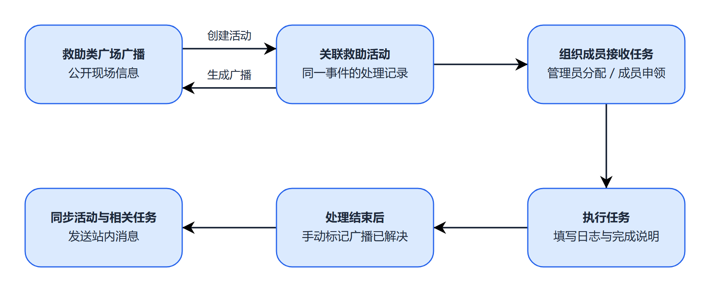

# 从哪里读源码

先沿一次上报操作阅读：Android 的 `ReportCatDialogFragment → CatApi`，对应后端的 `CatController → CatService → CatReport / Cat → Repository`。

- [认证控制器](../src/main/java/com/ourcat/backend/controllers/AuthController.java)：验证码、注册、登录与 BCrypt。
- [猫咪服务](../src/main/java/com/ourcat/backend/services/CatService.java)：上报、匹配、确认档案。
- [救助服务](../src/main/java/com/ourcat/backend/services/RescueService.java)：任务分配、申领、日志和权限判断。
- [本地图片](../src/main/java/com/ourcat/backend/utils/LocalImageStorage.java)：上传票据、内容校验、持久化。
- [demo 初始化](../src/main/java/com/ourcat/backend/services/DemoDataInitializer.java)和[启动保护](../src/main/java/com/ourcat/backend/config/DemoProfileGuard.java)：本地入口怎样与生产配置隔离。

上报先保存记录，再执行匹配；提交响应只包含基础信息，匹配结果通过上报详情查询。`performAsyncMatching()` 当前由同一个 Service 内部调用，Spring 的异步代理不会因此自动生效；该流程不能据此承诺请求已经交给独立后台任务。

## 匹配规则

实现位于 [CatService](../src/main/java/com/ourcat/backend/services/CatService.java) 与 [AiService](../src/main/java/com/ourcat/backend/services/AiService.java)，依次完成候选筛选、得分计算和档案关联。

| 步骤 | 当前实现 |
| --- | --- |
| 地理候选 | 筛选本次坐标周围 15 km 内的历史上报，以已经关联档案的记录参与比较 |
| 文字相似度 | 按顿号、逗号和空白拆分关键词集合，使用 Jaccard：交集数量 / 并集数量 |
| 文字加权 | 毛色 × 0.5 + 特征 × 0.3 + 性格 × 0.2；缺失字段得分为 0 |
| 图片得分 | 调用所配服务提取向量，计算余弦相似度，再以 `(cosine + 1) / 2` 映射到 0～1 |
| 图文融合 | 有双方图片向量时，文字 × 0.5 + 图片 × 0.5；否则使用文字分 |
| 档案关联 | 在达到阈值的候选中选最高分，未找到则创建新档案 |

默认判定为：综合分至少 0.68 且图片分至少 0.62；仅用文字时，文字分至少 0.68。可调整配置为 `ourcat.match.combined-threshold`、`ourcat.match.min-image-score-when-both` 和 `ourcat.match.text-only-threshold`。0.62 指归一化后的图片得分。

Replicate 的默认模型配置为 `krthr/clip-embeddings`，也保留了自托管服务等接入方式。向量保存时记录模型名和维度；更换模型需要处理既有向量，不能直接假定不同模型的特征可相互比较。项目未训练专门的猫咪个体识别模型，也未给出标注数据集上的准确率结果。

匹配结果和上报本身分别保存，详情接口提供当前关联与附近候选；确认关联、另建档案和合并档案用于后续整理。`confirmed` 是确认标记，不表示模型已经验证识别正确。

## 广场、活动和任务



救助类 `SquarePost` 创建时尝试创建 `RescueActivity`；从救助入口创建活动时，控制器也会尝试生成广播。成功后分别保存 `rescueActivityId` 与 `squarePostId`。代码会捕获关联创建异常，相关失败与回滚行为尚未专项验证。

活动下面可以有多个 `RescueTask`，每个任务对应执行人，`RescueTaskLog` 保存执行记录。活动完成后不再接受分配或申领；分配对象需要属于对应组织，同一成员不能在一个活动里重复领取或被分配任务。

将关联广播标记为已解决时，后端会尝试完成活动、同步任务并发送站内消息；相关猫咪状态只在符合条件时恢复“活跃”，已有“收养”“已故”等受保护状态不被覆盖。消息通过站内列表读取，尚未接入手机系统推送。

## 地图与位置

普通构建在 `MainActivity` 中保留 `MapFragment`，通过容器的显示、隐藏在地图和业务页面之间切换；来自档案、广场和救助详情的位置请求可以回到同一地图。Demo 不初始化这套真实地图流程。

地图点位、热力数据和活跃区域推荐使用上报位置。它们是对现有记录的整理，记录较少时不能据此推断校园中没有猫咪，推荐区域也不等于救助紧急程度。附近宠物医院由客户端高德 POI 搜索提供，需要地图 Key 和网络。

生产数据库使用 MySQL 8 与 Flyway，迁移 SQL 位于 `src/main/resources/db/migration`。dev/demo 使用 H2 和 JPA 建表；完整 MySQL 回归仍需单独验证，升级前先备份。

## 数据关系

```
User ──┬── CatReport (上报者)        ← 谁上报了这只猫
       ├── Post / PostVote (论坛)    ← 谁发了帖子
       ├── RescueTask (执行者)       ← 谁在执行救助
       ├── SquarePost (广场)         ← 谁发了广播
       ├── Message (收发)           ← 消息发给谁
       └── OrganizationMember        ← 属于哪个组织

Cat ──┬── CatReport (上报记录)      ← 这只猫的所有目击记录
      └── RescueActivity (救助目标) ← 这只猫关联的救助活动

Organization ──┬── OrganizationMember  ← 组织有哪些成员
                └── RescueActivity     ← 组织发起了哪些救助

SquarePost ─────── RescueActivity     ← 广场救助帖关联的救助活动
```

### 核心表结构速览

| 表名 | 关键字段 | 说明 |
| :--- | :--- | :--- |
| `users` | `id, username, password(BCrypt), role, nickname, avatar_url` | 用户表，角色分普通用户/志愿者/管理员（`role` 为 1/2/3） |
| `cats` | `id, name, color, feature, personality, status, primary_image_url, ai_embedding` | 猫咪档案表，`ai_embedding` 存储图片特征向量用于以图搜猫 |
| `cat_reports` | `id, lat, lng, report_time, image_url, description, cat_id, user_id, match_confidence, confirmed, ai_suggested_cat_id` | 猫咪上报记录，一次上报可能关联到已有猫咪或创建新猫 |
| `posts` | `id, title, content, images, likes, dislikes, user_id, pinned, referenced_cat_id` | 论坛帖子，图片 URL 以 JSON 字符串保存 |
| `comments` | `id, content, post_id, user_id, created_at` | 论坛评论；当前表结构没有嵌套评论字段 |
| `square_posts` | `id, text, images, location, type, status, likes, user_id, referenced_cat_id, rescue_activity_id` | 广场广播，可关联猫咪和救助活动 |
| `rescue_activities` | `id, title, description, cat_id, square_post_id, organization_id, problem_type, urgency, status, created_by` | 救助活动，状态值为 `created`、`in_progress`、`completed` |
| `rescue_tasks` | `id, rescue_activity_id, assignee_user_id, assigner_user_id, status, assigned_at, completed_at, completion_note, completion_images` | 救助子任务，可指派或由组织成员申领 |
| `rescue_task_logs` | `id, rescue_task_id, user_id, log_type, content, images, created_at` | 救助日志，记录进度和现场照片 |
| `organizations` | `id, name, description, created_at` | 救助组织 |
| `organization_members` | `id, organization_id, user_id, role, joined_at` | 组织成员关系 |
| `messages` | `id, type, content, target_type, target_id, user_id, is_read, created_at` | 用户消息、通知和天气预警记录 |

> 📌 完整建表语句见 `src/main/resources/db/migration/` 下的 25 个 Flyway 迁移脚本。

---
