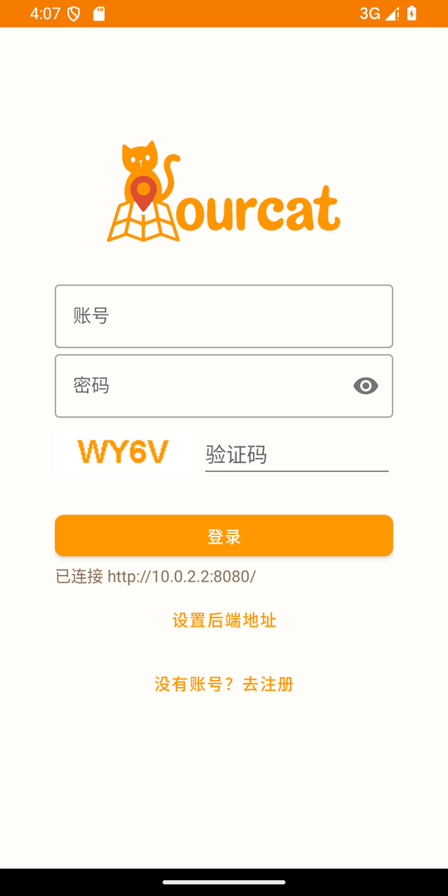
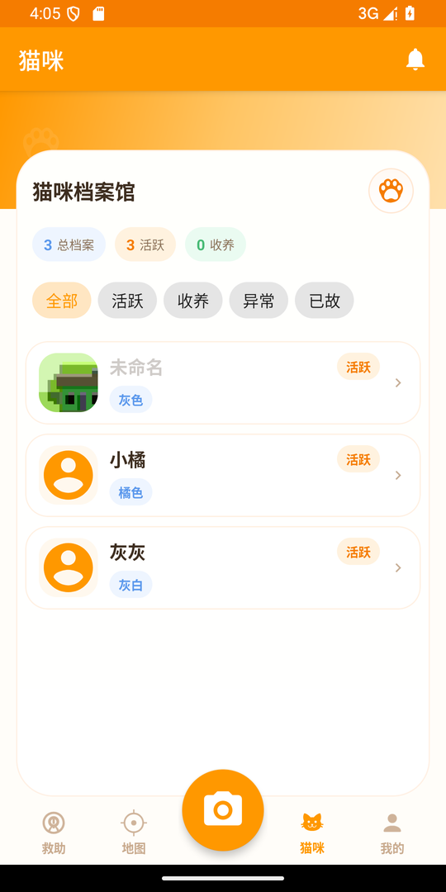
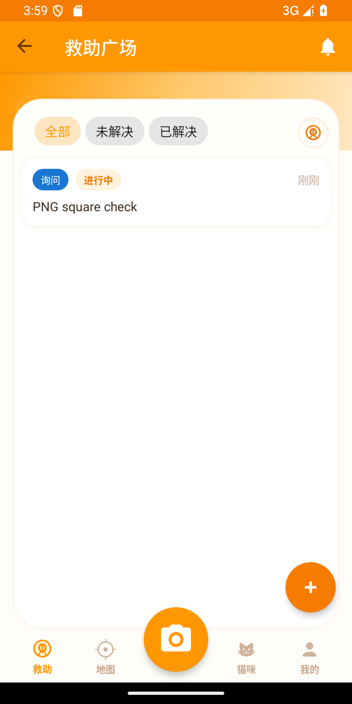
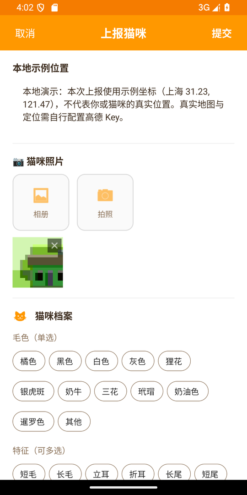

# 本地 Demo 截图与演示

[下载体验包](https://github.com/BlackCoder0/OurCat_backend/releases/tag/v0.1.0-local-preview.2) · [MP4 操作演示](https://github.com/BlackCoder0/OurCat_backend/releases/download/v0.1.0-local-preview.2/OurCat-demo-walkthrough-preview2.mp4)

以下画面来自 Windows 本地后端与 Pixel 3 API 35 模拟器，使用 preview.2 APK。账号由本地启动器生成，帖子和上报是测试内容；没有连接线上数据库。

## 登录和查看猫咪

| 登录页 | 猫咪列表 |
| :---: | :---: |
|  |  |

模拟器使用 `http://10.0.2.2:8080/` 连接本机。实体手机需要填写电脑实际 Wi-Fi 地址；不能照抄模拟器地址。初次启动有两只示例猫咪，截图中的“未命名”来自本轮测试上报。

## 发帖和广播

| 带图论坛帖子 | 广场广播 |
| :---: | :---: |
|  |  |

两处均从系统选择器选取 PNG，经客户端转为 JPEG 后上传。已检查帖子记录、图片 URL、实际图片格式和电脑上的文件。论坛返回列表后可能仍显示缓存内容，下拉刷新可以查看刚发布的帖子。

## 猫咪上报

图中的绿色画面由模拟器相机生成，用于验证选图、上传和提交。已提交一次测试记录，并核对后端坐标为 `31.23, 121.47`。此位置只是上海示例坐标，不能用于记录实际发现猫咪的位置。

## 录屏怎样看

演示包含后端地址设置、正常图片验证码登录、猫咪列表、带图发帖、广场广播和猫咪上报。画面来自实际操作，经过剪辑并缩短部分等待；猫咪列表一段使用标明的实际截图停留展示。字幕说明使用条件，视频没有声音。

演示没有展示组织审核、成员任务的完整手机端操作。相应后端 API 有测试，所有角色页面仍需逐项验收。

## 体验范围

- 电脑要持续运行后端；账号、内容和图片保存在这台电脑。
- Demo 不提供真实地图、定位、附近医院查询或图片 AI。需要这些能力时，从源码配置自有服务。
- 救助日志目前可以填写文字，日志选图界面尚未实现。
- 当前素材不能证明实体手机、其他 Windows 电脑和生产配置已经验收。具体范围见[验证记录](validation.md)。
